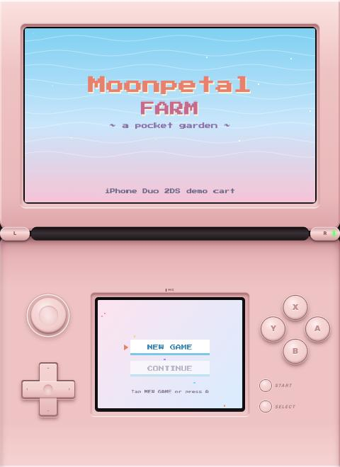
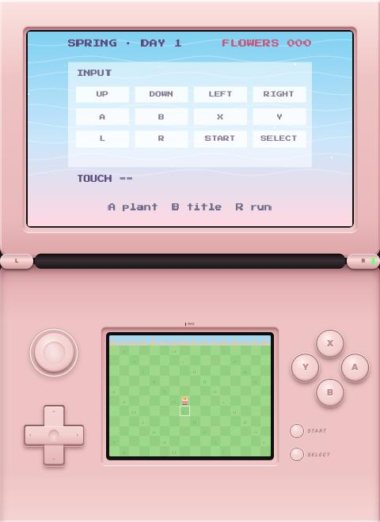
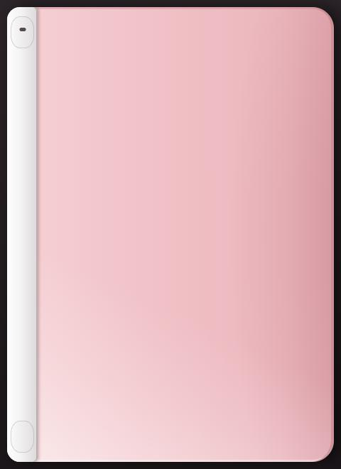
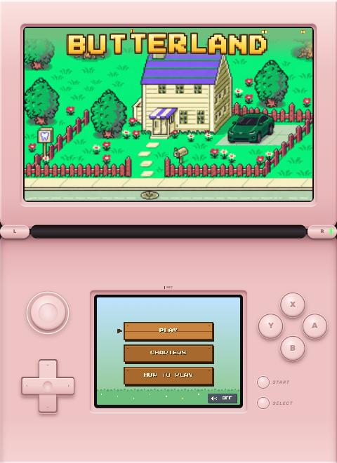

# iPhone Duo 2DS

A pink, dual-screen handheld that runs in the browser, made for the iPhone Duo foldable and happy on any phone, tablet or computer. Bring your own game: write one `game.js` (or ask an AI to vibe-code it for you), drop it in, and play it on two screens.

**Try the demo:** https://yikolim.github.io/iphoneduo-2ds/

<p>
  
  
  
</p>

<sub>The demo game, and the closed lid that a folded phone shows before you open it.</sub>

> **A note on proportions:** this handheld is inspired by the Nintendo 2DS / 3DS family, not a copy of it. The original screen and shell ratios have been tweaked to make the best use of modern phone, foldable and computer screens: the top screen is a wide 5:3 (400×240), the two halves are resized to fit the frame, and the buttons are made larger for thumbs. It is a fan-made tribute and is not affiliated with or endorsed by Nintendo.

## What you get

- **Two screens, like a 2DS.** A wide top screen (400×240) and a touch screen (256×192) underneath.
- **New 2DS XL-style controls, sized for thumbs.** A circle pad above the D-pad on the left; the A/B/X/Y diamond with START and SELECT under it on the right; L/R on the hinge. The circle pad steers in 8 directions (the same UP/DOWN/LEFT/RIGHT as the D-pad), keeps following your thumb even if it slides off, and springs back when you let go.
- **Made for the iPhone Duo.** On a foldable or tablet the handheld fills the screen, one half per side of the fold. Everywhere else it sits in an upright Duo-shaped frame. Both halves are raised pink panels on a dark phone body, with the lid casting a shadow onto the lower half.
- **A closed lid on the outer screen.** On a folded phone (or any small touch screen) you first see the back of a pink lid. Unfold the phone, or tap, and it swings open and your game starts. Fold it again and the game pauses.
- **Every way to play.** Touch the on-screen buttons, use a keyboard, or tap the bottom screen.
- **Haptics.** `DS.haptic()` buzzes the phone where the browser allows it.
- **No build step.** Plain HTML and JavaScript. Open `index.html`, or host the folder anywhere static.

## Files

| File | What it is |
| --- | --- |
| `index.html` | The handheld: shell, buttons, screens, lid, input and the game loop. You usually don't need to touch it. |
| `game.js` | The game. Right now it's the demo, *Moonpetal Farm* (walk a little garden and plant flowers). **Replace this with your own.** |
| `icon.svg` | The browser tab icon. |
| `LICENSE` | MIT. |

## Put your own game in

1. Replace `game.js` with your game. The only rule: it calls `DS.setGame({...})` once.
2. Open `index.html` in a browser (or run a tiny server, below) and play.

The smallest possible game:

```js
// game.js
let x = 128, y = 96;
DS.setGame({
  init() {
    DS.on("down", btn => { if (btn === "A") DS.haptic([30]); });
    DS.on("touch", p => { x = p.x; y = p.y; });
  },
  update(dt) {
    const speed = 80 * dt;
    if (DS.isDown("LEFT")) x -= speed;
    if (DS.isDown("RIGHT")) x += speed;
    if (DS.isDown("UP")) y -= speed;
    if (DS.isDown("DOWN")) y += speed;
  },
  draw(top, bottom) {
    top.fillStyle = "#9fd4f5"; top.fillRect(0, 0, 400, 240);
    top.fillStyle = "#222d35"; top.font = "16px monospace"; top.fillText("Hello, Duo!", 140, 120);
    bottom.fillStyle = "#fffde6"; bottom.fillRect(0, 0, 256, 192);
    bottom.fillStyle = "#ff8fb1"; bottom.fillRect(x - 6, y - 6, 12, 12);
  }
});
```

### Vibe-coding it

Paste something like this into your AI assistant, then put what it writes into `game.js`:

> Write a browser game as a single `game.js` for the "iPhone Duo 2DS" shell. Don't create any HTML. The shell gives you a global `DS` object: `DS.setGame({ init(), update(dt), draw(top, bottom) })` where `top` is a 400×240 canvas 2D context and `bottom` is a 256×192 touch-screen context; `DS.isDown(button)` and `DS.on("down" | "up", fn(button))` for the buttons UP DOWN LEFT RIGHT A B X Y L R START SELECT; `DS.on("touch", fn({x, y, phase}))` for taps on the bottom screen (x/y in its 256×192 pixels, phase start | move | end); `DS.haptic([ms, pause, ms…])` to buzz. Use pixel art (no smoothing), keep everything in the one file, and save progress in localStorage if it's useful. My game idea: …

## The `DS` API

| Call | What it does |
| --- | --- |
| `DS.setGame({ init, update, draw })` | Plugs your game in. `init()` runs once, `update(dt)` every frame with `dt` in seconds, `draw(top, bottom)` every frame with the two 2D contexts. |
| `DS.isDown(button)` | `true` while a button is held. The circle pad shows up as UP/DOWN/LEFT/RIGHT too. |
| `DS.on("down" \| "up", fn)` | `fn(button)` once per press or release. Returns a function that removes the listener. |
| `DS.on("touch", fn)` | `fn({ x, y, phase })` for the bottom screen. `x`/`y` are in the bottom screen's 256×192 pixels; `phase` is `start`, `move` or `end`. |
| `DS.buttons` | `["UP","DOWN","LEFT","RIGHT","A","B","X","Y","L","R","START","SELECT"]` |
| `DS.top`, `DS.bottom` | The two `<canvas>` elements (400×240 and 256×192). |
| `DS.haptic(pattern)` | Vibrates: `[on, off, on, …]` in milliseconds. Android vibrates fully; iPhone Safari (iOS 18+) gets one light tap per "on". Elsewhere it does nothing. |
| `DS.lidClosed()` | `true` while the closed lid is showing. A `ds-lid` event (`{ detail: { open } }`) fires on `window` whenever it opens or closes. Pause your game while it's closed if you like. |

Keyboard: arrows = D-pad, X = A, Z = B, S = X, A = Y, Q/W = L/R, Enter = START, Shift = SELECT.

Browsers only allow sound after the first tap or key press, so start music from a button handler rather than on load.

## Layout options

Add these to the page address:

- `?classic`: a plain DS Lite-style handheld that resizes to the window, without the Duo frame.
- `?duo`: fill the whole screen with the Duo layout, even on a computer.
- `?cover`: start with the closed lid, even on a computer.

## Run it locally

Any static server works:

```bash
npx serve .
```

```bash
python3 -m http.server 8000
```

Then open the address it prints.

## Host it on GitHub Pages

1. Push this folder to a GitHub repository.
2. In the repository's **Settings → Pages**, set the source to your main branch and the root folder.
3. Your handheld is live at `https://<your-name>.github.io/<repo-name>/`.

## Made with it

**[Butterland](https://yikolim.github.io/butterland/)**, a cozy pixel game, runs on this handheld.



Made something? Open an issue or pull request to add it here.

## License

MIT. Make it yours, and share what you build.
